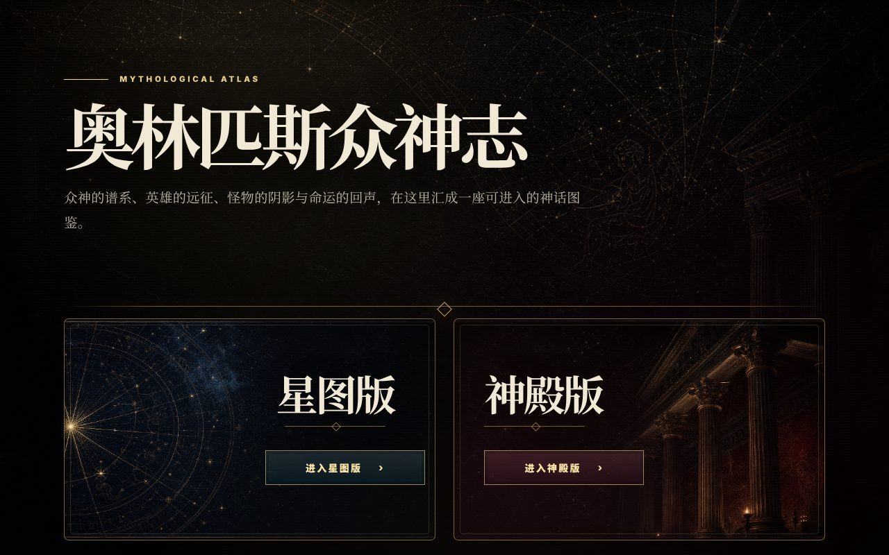

# 古希腊神话全景 · Ancient Greek Mythology

> 古文明系列：[Ancient Egypt](https://github.com/chengwq95/ancient-egypt) · [Ancient Mesopotamia](https://github.com/chengwq95/ancient-mesopotamia) · [Ancient Greece](https://github.com/chengwq95/ancient-greek)

一个中英双语的古希腊神话互动图鉴。以众神、泰坦、英雄、凡人和怪物为线索，通过人物档案、神祇谱系、经典故事与古代文献进入奥林匹斯的神话世界。

## 在线访问

[ancient-greek-stories.pages.dev](https://ancient-greek-stories.pages.dev/)

## 内容

入口提供星图版与神殿版两种视觉路线。两种版本均涵盖古希腊神话简介、人物图鉴、神祇关系谱系、经典神话故事、推荐阅读路径、主要古代文献、完整人物索引与关于本站。

## 特性

- **中英双语**，支持中文、英文与双语阅读
- **双版本体验**，可选择星图典藏风格或神殿博物馆风格
- **人物图鉴**，支持关键词搜索、类别筛选、排序与完整索引
- **私人收藏与足迹**，保存收藏人物、最近浏览与随机探索结果
- **神祇关系谱系**，以可横向浏览的世代关系图连接人物档案
- **经典神话与古代文献**，并列呈现故事、版本差异和主要来源
- 主题切换、响应式设计、键盘操作、焦点样式与 ARIA 支持

## 声明

- **页面中的入口与氛围图像为 AI 生成的数字创作**，仅用于视觉呈现，不能作为古代艺术或文物的视觉依据。
- 内容为科普性整理，不是学术出版物；希腊神话在不同诗人、地区与时代之间存在多种版本。
- 人物关系、译名与故事细节以页面中的古代文献说明和版本提示为参考。

## 许可

内容与代码以 [CC BY-NC 4.0](LICENSE) 授权：可在署名且非商业的前提下分享与改编。
